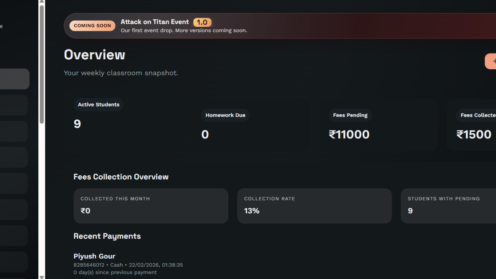
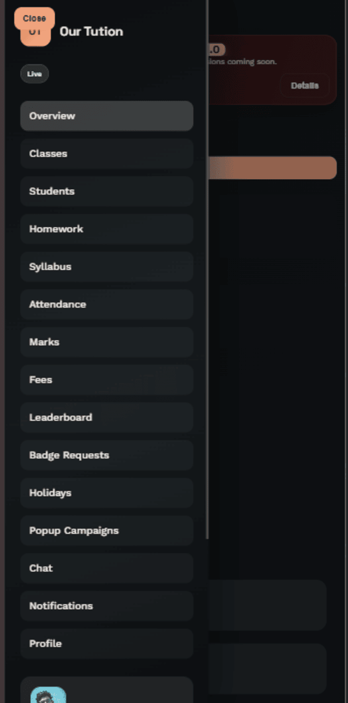

# Our Tution

**Our Tution** is a responsive tuition-classroom management app for teachers and students. It brings classroom administration, student learning tools, and progress tracking together in an installable Progressive Web App (PWA).

## Features

- **Teacher workspace:** dashboard, classes, student directory and profiles, attendance, marks, homework, syllabus, holidays, fees, invoices, and receipts.
- **Student portal:** access to learning materials, homework, fees, marks, quizzes, badges, and a learning-level journey.
- **Communication:** announcements, direct chat, online presence, typing indicators, and in-app and web push notifications.
- **Learning and motivation:** quizzes for classes 6–8, leaderboards, XP, levels, and achievement badges.
- **Responsive PWA:** installable on supported devices, with service-worker updates, offline-aware API caching, and a mobile-friendly interface.
- **Account and administration tools:** registration, sign-in, password recovery, profiles, badge requests, and popup campaigns.

## Screenshots

| Desktop | Mobile |
| --- | --- |
|  |  |

## Technology

### Frontend

- React 18 and React Router
- Vite
- Axios
- Socket.IO client
- Firebase client SDK for web push notifications
- IndexedDB/local storage for offline-aware data caching
- Vite PWA plugin and service workers

### Backend

The API is an Express application maintained in the [backend repository](https://github.com/AyushGour-crack-it/tution-app-backend). It uses MongoDB/Mongoose, JWT-based authentication, Socket.IO, and optional Redis, Firebase Admin, Cloudinary, Google sign-in, and Razorpay integrations.

## Project layout

```text
.
├── src/                    # React application
│   ├── features/quiz/      # Quiz dashboard, setup, and results
│   └── ui/                 # App shell, pages, shared UI, API and offline utilities
├── public/                 # PWA assets, service workers, fonts, and screenshots
├── cardIMAGES/             # Application image assets
├── package.json            # Frontend scripts and dependencies
└── backend/                # Backend repository checkout (see link above)
```

## Requirements

- Node.js 18 or later and npm
- A modern browser
- For persistent backend data: a MongoDB connection
- Optional provider accounts/credentials for Google sign-in, Firebase push notifications, Cloudinary uploads, Razorpay payments, or Redis-backed Socket.IO scaling

## Run locally

### 1. Start the API

The backend is maintained separately. Clone it alongside this repository:

```bash
git clone https://github.com/AyushGour-crack-it/tution-app-backend.git
cd tution-app-backend
npm install
```

Create an `.env` file in the backend repository's root. At minimum, configure:

```dotenv
PORT=5000
CLIENT_ORIGIN=http://localhost:5173
MONGODB_URI=your_mongodb_connection_string
JWT_SECRET=replace_with_a_random_secret_of_at_least_32_characters
```

Start the API:

```bash
npm run dev
```

The API health check is available at `http://localhost:5000/api/health`. If `MONGODB_URI` is omitted, the server can start in offline mode by default, but database-backed features will not be available or persisted. Set `ALLOW_OFFLINE_MODE=false` to require a working database connection.

Optional backend environment variables:

| Variable(s) | Purpose |
| --- | --- |
| `GOOGLE_CLIENT_ID` | Verify Google sign-in credentials |
| `CLOUDINARY_CLOUD_NAME`, `CLOUDINARY_API_KEY`, `CLOUDINARY_API_SECRET` | Cloudinary media uploads |
| `RAZORPAY_KEY_ID`, `RAZORPAY_KEY_SECRET` | Fee payment integration |
| `FIREBASE_PROJECT_ID`, `FIREBASE_CLIENT_EMAIL`, `FIREBASE_PRIVATE_KEY` | Server-side Firebase push notifications |
| `REDIS_URL` | Redis adapter for scaling Socket.IO across server instances |
| `ALLOW_VERCEL_WILDCARD` | Allow Vercel preview origins when set to `true` |
| `APP_FEATURE_VERSION`, `APP_FEATURE_NOTE` | Customize the feature-update announcement |
| `TEACHER_ACCESS_ID` | Configure the teacher registration access ID |

Keep backend secrets in the backend's environment and never commit them.

### 2. Start the frontend

From the root of this repository:

```bash
npm install
```

Copy `.env.example` to `.env` and configure the API URL:

```dotenv
VITE_API_URL=http://localhost:5000/api
```

Start the Vite development server:

```bash
npm run dev
```

Open `http://localhost:5173`. The frontend environment template also includes Firebase web configuration and a VAPID public key for browser push notifications. Configure these values in your Firebase project if you want to enable push notifications. `VITE_RAZORPAY_KEY_ID` is included for the payment client configuration.

Vite exposes `VITE_*` values in the browser bundle. Use only public client configuration there; keep private keys and service-account credentials on the backend.

## Scripts

Run these from the repository root:

| Command | Description |
| --- | --- |
| `npm run dev` | Start the frontend development server on port 5173 |
| `npm run build` | Build the production frontend into `dist/` |
| `npm run preview` | Serve the production build locally for review |

The backend provides `npm run dev` (Node watch mode) and `npm start`.

## API overview

The backend exposes JSON endpoints under `/api`, including:

`/auth`, `/overview`, `/students`, `/classes`, `/homeworks`, `/syllabus`, `/attendance`, `/holidays`, `/fees`, `/invoices`, `/receipts`, `/chat`, `/announcements`, `/marks`, `/notifications`, `/leaderboard`, `/badges`, `/quiz`, and `/popup-campaigns`.

Socket.IO provides realtime events for chat and presence. The frontend uses `VITE_API_URL` for both HTTP API requests and the realtime server URL.

## Production deployment

- Build and deploy the frontend as a static Vite site. The repository includes a Vercel configuration for serving the app and routing client-side paths to `index.html`.
- Deploy the backend separately and provide its production environment variables through the hosting provider's secret/environment settings.
- Set the frontend's `VITE_API_URL` to the deployed API base URL, such as `https://api.example.com/api`.
- Set the backend's `CLIENT_ORIGIN` to the deployed frontend origin(s) so browser API and Socket.IO requests pass the configured origin checks.
- Configure Firebase, Google, payment, and media provider origins/credentials as required by the integrations you enable.

## Security and configuration

- Do not commit `.env` files, private keys, database credentials, or provider secrets.
- Use a unique, strong `JWT_SECRET` of at least 32 characters in production.
- Restrict CORS to trusted frontend origins; only enable preview-origin wildcards when needed.
- Treat Vite `VITE_*` settings as public because they are bundled into client-side code.

## License

No license file is currently included in this repository. Contact the project owner for permission before redistributing or reusing the project.
